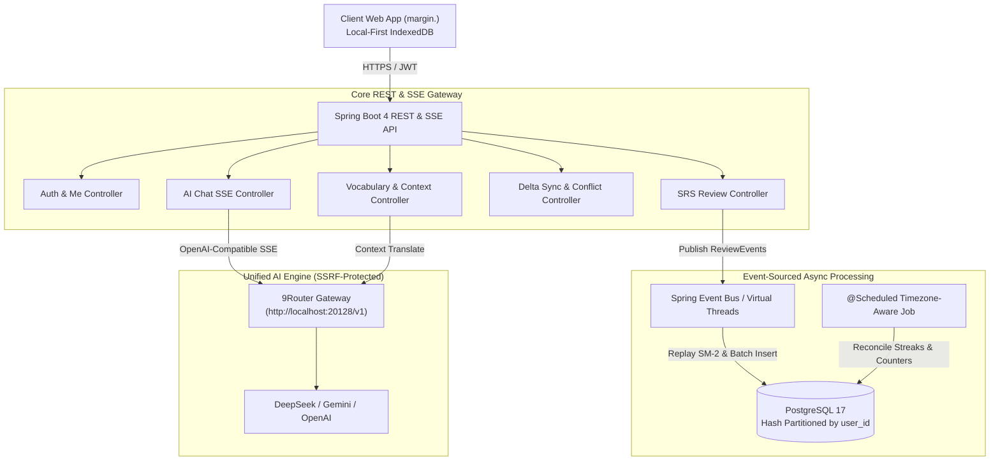
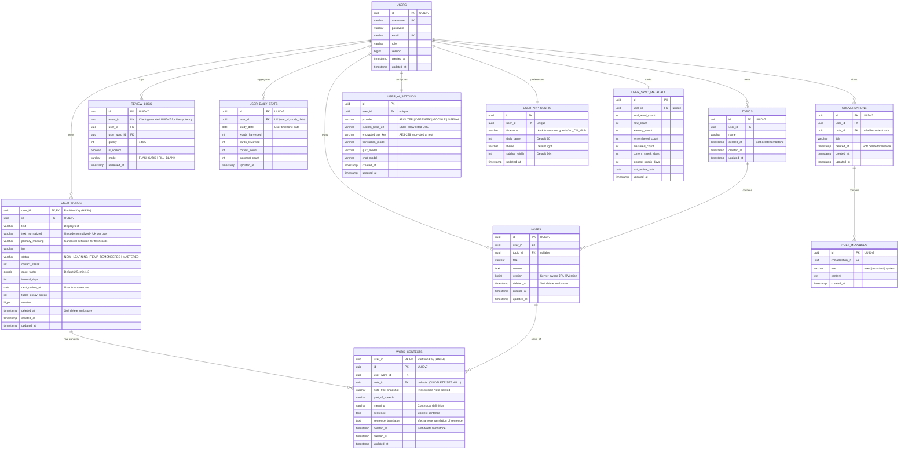

# Business Requirements Document (BRD) - Backend (v2.1 Finalized)
## English Learning Web Application Backend (Target UI: **margin.**)

---

### 1. Document Control
| Version | Date | Author | Description |
| :--- | :--- | :--- | :--- |
| 1.0.0 | 2026-06-28 | Antigravity AI | Initial draft capturing core schema, sync workflows, and AI integration requirements. |
| 1.1.0 | 2026-10-16 | Antigravity AI | Architectural overhaul: User-scoped Multi-Context Vocabulary, Read-First optimization, Paced SRS reviews, and Delta Sync. |
| 2.0.0 | 2026-10-16 | Antigravity AI | Architecture aligned with `answer.md` Round 1: 45-Word Sliding Window Cache, PostgreSQL Hash Partitioning + HOT Update (`fillfactor=80`), UUIDv7, Async Write Pipeline, and AI Chat Companion via `9Router` SSE Streaming. |
| 2.1.0 | 2026-10-16 | Antigravity AI | **Contract & Architecture Alignment (Round 2)**: Re-aligned with Frontend Local-First reality. Clarified data ownership (`primary_meaning` vs context `meaning`), Event-Sourcing SRS replay (`eventId`), soft delete tombstones (`deleted_at`), IANA Timezone support, Server-owned Delta Sync (`cursor`), single-name OpenAPI contract, and SSE Chat over HTTP fetch. |

---

### 2. Executive Summary
The **English Learning Web Application (`margin.`)** is an editorial-grade platform designed to help users master English vocabulary and contextual writing through structured notes, spaced repetition learning (SRS), and an interactive AI Chat Companion.

Following the definitive architectural resolutions ([`answer.md`](file:///Users/hieuquockieu/Desktop/workspace/learning%20english/learning_english_be/docs/answer.md) Rounds 1 & 2), the backend is structured around four architectural pillars:

1. **Local-First Alignment with Authoritative Cloud Sync**:
   - The client application operates with full offline autonomy backed by client-side IndexedDB.
   - The backend serves as the **authoritative source of truth for conflict resolution, delta synchronization, and cross-device hydration**.
   - Sync leverages a server-issued monotonic `cursor`, soft-delete tombstones (`deleted_at`), and an event-sourced review log replay pipeline.
2. **Physical Optimization & Hot-Path Efficiency**:
   - High-throughput write isolation: `user_words` retains only SRS numeric/date columns plus `primary_meaning` with `fillfactor = 80` to activate **PostgreSQL Heap-Only Tuple (HOT)** in-place updates.
   - Scalable multi-tenancy: Declarative Hash Partitioning (`PARTITION BY HASH (user_id)`) on `user_words` and `word_contexts` ensures compact B-Tree index pages and eliminates random disk I/O.
   - Uniform monotonic **UUIDv7** identifiers across all entities (client-generated and server-validated).
3. **User-Scoped Multi-Context Vocabulary & Unicode Deduplication**:
   - Lexicon deduplicated per user on `(user_id, text_normalized)` using a shared Unicode normalization specification: `trim -> lowercase -> strip non-letter boundary characters -> collapse inner whitespace`.
   - Each word maintains a `primary_meaning` for fast card display, alongside multiple contextual instances (`word_contexts`) recording the source sentence, translation, grammatical part of speech, and note snapshot.
4. **Timezone-Aware SRS Progression & Bento Analytics**:
   - User-configured IANA timezone (`UserAppConfig.timezone`) guarantees consistent daily boundaries (`study_date`), streak tracking, and `next_review_at` calculations regardless of client UTC offsets.
   - Spaced repetition adheres to a deterministic 4-stage progression with client event idempotency (`eventId`).
5. **Unified AI Engine (`9Router` / OpenAI-Compatible / Gemini) with SSE**:
   - Integrated gateway routing requests to local self-hosted `9Router` (`http://localhost:20128/v1` with 3-tier fallback) or direct LLM providers with strict SSRF URL allow-listing.
   - Contextual chat companion streaming tokens via Server-Sent Events (`text/event-stream`).

---

### 3. System Architecture & Data Flow

---

### 4. Functional Requirements

#### 4.1. Authentication & Bootstrap
- **Endpoints**: `POST /api/auth/register`, `POST /api/auth/login`, `GET /api/auth/me`.
- **Bootstrap Metadata**: `GET /api/auth/me` returns the authenticated user profile, `AppConfigDto` (including `timezone`, `dailyTarget`, `theme`), and `SyncCountersResponse` (`dueCount`, `reviewedToday`, `totalWords`, `streakDays`).

#### 4.2. Topics & Notes Management
- **Topic Endpoints**: `GET /api/topics`, `POST /api/topics` (idempotent upsert with client UUIDv7), `PUT /api/topics/{id}`, `DELETE /api/topics/{id}`.
- **Note Endpoints**: `GET /api/notes`, `GET /api/notes/{id}`, `POST /api/notes`, `PUT /api/notes/{id}`, `DELETE /api/notes/{id}`.
- **Cascade Soft-Delete & Snapshot Preservation**:
  - Deleting a Topic soft-deletes the topic (`deleted_at = now()`) and cascade soft-deletes all contained Notes.
  - Deleting a Note preserves all harvested vocabulary contexts: sets `note_id = NULL` on associated `word_contexts` while retaining `note_title_snapshot` and context sentences.

#### 4.3. Multi-Context Vocabulary Engine (`UserWord` & `WordContext`)
- **Deduplication Rule**: Enforced per user on `(user_id, text_normalized)` where `text_normalized` is computed by the standard Unicode normalization algorithm.
- **Capturing Word Context (`POST /api/words/context`)**:
  - If word does not exist: Creates `UserWord` (`primary_meaning`, `status = NEW`, `correctStreak = 0`, `nextReviewAt = today`) and appends initial `WordContext`.
  - If word already exists: Appends new `WordContext` (`sentence`, `sentenceTranslation`, `meaning`, `partOfSpeech`, `noteId`, `noteTitleSnapshot`) to existing word. **SRS progress remains 100% untouched.**
- **Automatic Multi-Device Deduplication**: When syncing a word whose normalized text already exists under a different UUID, the server automatically merges contexts into the canonical server record and returns an `idRemap` dictionary (`clientId -> canonicalServerId`).

#### 4.4. Spaced Repetition (SRS) Engine & Event-Sourced Review
- **4-Stage Status Progression**:
  1. `NEW`: Newly harvested word, `correctStreak = 0`, zero review logs.
  2. `LEARNING`: Actively learning or recently forgotten (`correctStreak` in `0..1`, reviewed at least once).
  3. `TEMP_REMEMBERED`: Short-term retention achieved (`correctStreak` in `2..4`).
  4. `MASTERED`: Long-term mastery achieved (`correctStreak >= 5` AND `intervalDays >= 14`).
- **Interval Progression Formula**:
  - `Interval[1] = 1 day`, `Interval[2] = 3 days`, `Interval[3] = 7 days`, `Interval[4] = 14 days`, `Interval[n >= 5] = round(Interval[n-1] * easeFactor)`.
  - Ease factor (`easeFactor`, default `2.5`, minimum `1.3`): Decreases by `0.2` on forgotten ratings (`quality < 3`); retains or adjusts on correct ratings.
- **Event-Sourced Review Submission (`POST /api/review/submit`)**:
  - Accepts an array of review events: `{ events: [{ eventId, wordId, quality, isCorrect, mode, reviewedAt }] }`.
  - Idempotent processing: Duplicate `eventId` records are safely ignored.
  - Server immediately calculates new authoritative SRS values in-memory, publishes async events for database ingestion, and responds with `200 OK` containing the updated word states.
- **Due Retrieval (`GET /api/review/due?limit=15&excludeIds=...`)**:
  - Queries active due words ordered by `(user_id, next_review_at ASC, status ASC)`.
  - Excludes currently active session cards via `excludeIds` to prevent skipping or repeating cards.
- **AI Synonym & Typo Diagnosis (`POST /api/review/check-answer`)**:
  - Online auxiliary endpoint: When client input fails exact match, queries AI to diagnose whether the submitted term is a valid contextual synonym (`SYNONYM_SUGGESTION`) before grading.

#### 4.5. Progress, Streak & 35-Day Dashboard (`GET /api/progress/dashboard`)
- **Timezone-Aware Calculations**: All daily buckets (`study_date`), streak checks, and review counts are calculated relative to the user's configured IANA timezone (`UserAppConfig.timezone`).
- **Streak Qualification**: A day is credited toward `streakDays` when the user **reviews >= 1 card OR harvests >= 1 new word** within that timezone date.
- **Dashboard Response Fields (Standardized Single-Contract)**:
  - `accuracyPercent`: Recall accuracy percentage over the past 30 days (`0..100` or `null`).
  - `reviewedToday`: Cards reviewed today.
  - `dailyTarget`: Daily card review target (default `20`).
  - `wordsAddedToday`: New words collected today.
  - `totalWords`: Total personal vocabulary count.
  - `streakDays`: Current consecutive study streak.
  - `longestStreakDays`: All-time longest study streak.
  - `distribution`: `{ new, learning, remembered, mastered }`.
  - `activityCalendar`: Array of exactly 35 daily tiles (`[{ date, count, wordsAdded, filled, isToday }]`).

#### 4.6. Delta Sync Protocol & Conflict Resolution (`POST /api/sync/delta`)
- **Push & Pull Protocol**:
  - Request: `{ cursor, changes: { topics, notes, words, wordContexts, reviewEvents }, deleted: { topicIds, noteIds, wordIds, contextIds } }`.
  - Response: `{ newCursor, changes: { topics, notes, words, wordContexts }, tombstones, idRemap, conflicts, counters }`.
  - `cursor`: Monotonic server-issued timestamp string ensuring safe synchronization without client clock dependence.
- **Soft Delete Tombstones**: Soft-deleted entities (`deleted_at IS NOT NULL`) are propagated as tombstones in delta responses, allowing all user devices to purge local records cleanly.
- **Note Conflict Resolution**:
  - Detected when a client pushes a note update with `baseVersion < serverVersion` and divergent text content.
  - Returned in the sync response as a `ConflictItem` containing local and cloud snapshots.
  - Resolved via `POST /api/sync/resolve-conflict` with explicit user intent (`KEEP_LOCAL` or `APPLY_CLOUD`).

#### 4.7. AI Chat Companion & `9Router` Integration
- **Server-Persisted Chat**: Conversations and messages are persisted in PostgreSQL (`conversations`, `chat_messages`).
- **Client-Generated IDs**: Clients generate UUIDv7 identifiers for new conversations to allow idempotent thread creation.
- **Streaming Protocol (`POST /api/chat/send`)**:
  - Implemented over HTTP `POST` using **Server-Sent Events (`text/event-stream`)** compatible with standard `fetch` + `ReadableStream`.
  - Events stream tokens incrementally: `event: meta` -> `event: chunk` -> `event: done` (or `event: error`).
  - Server automatically loads conversation history from PostgreSQL and appends referenced note/word contexts into the system prompt.

---

### 5. Database Schema & Physical Optimization Design (ERD)

---

### 6. Storage Internals & Physical Tuning

1. **Declarative Hash Partitioning**:
   - `user_words` and `word_contexts` are partitioned by `HASH (user_id)` across 16 partitions (`user_words_p0` .. `user_words_p15`).
2. **PostgreSQL HOT Updates (`fillfactor = 80`)**:
   - `ALTER TABLE user_words SET (fillfactor = 80);`
   - Heavy textual context lives in `word_contexts`. Daily SRS updates only mutate fixed numeric/date columns on `user_words`, staying on the same 8KB disk page.
3. **Monotonic UUIDv7**:
   - All primary keys generate monotonic sequential UUIDv7 values to append sequentially onto B-Tree leaf pages without index fragmentation.
4. **Composite Indexes**:
   - `idx_user_words_due`: `(user_id, next_review_at ASC, status ASC) WHERE deleted_at IS NULL`
   - `idx_user_words_lookup`: `UNIQUE (user_id, text_normalized) WHERE deleted_at IS NULL`
   - `idx_user_words_updated`: `(user_id, updated_at DESC)`
   - `idx_word_contexts_word`: `(user_id, user_word_id) WHERE deleted_at IS NULL`
   - `idx_review_logs_event`: `UNIQUE (event_id)`
   - `idx_daily_stats_user_date`: `UNIQUE (user_id, study_date DESC)`
   - `idx_notes_sync`: `(user_id, updated_at DESC)`
