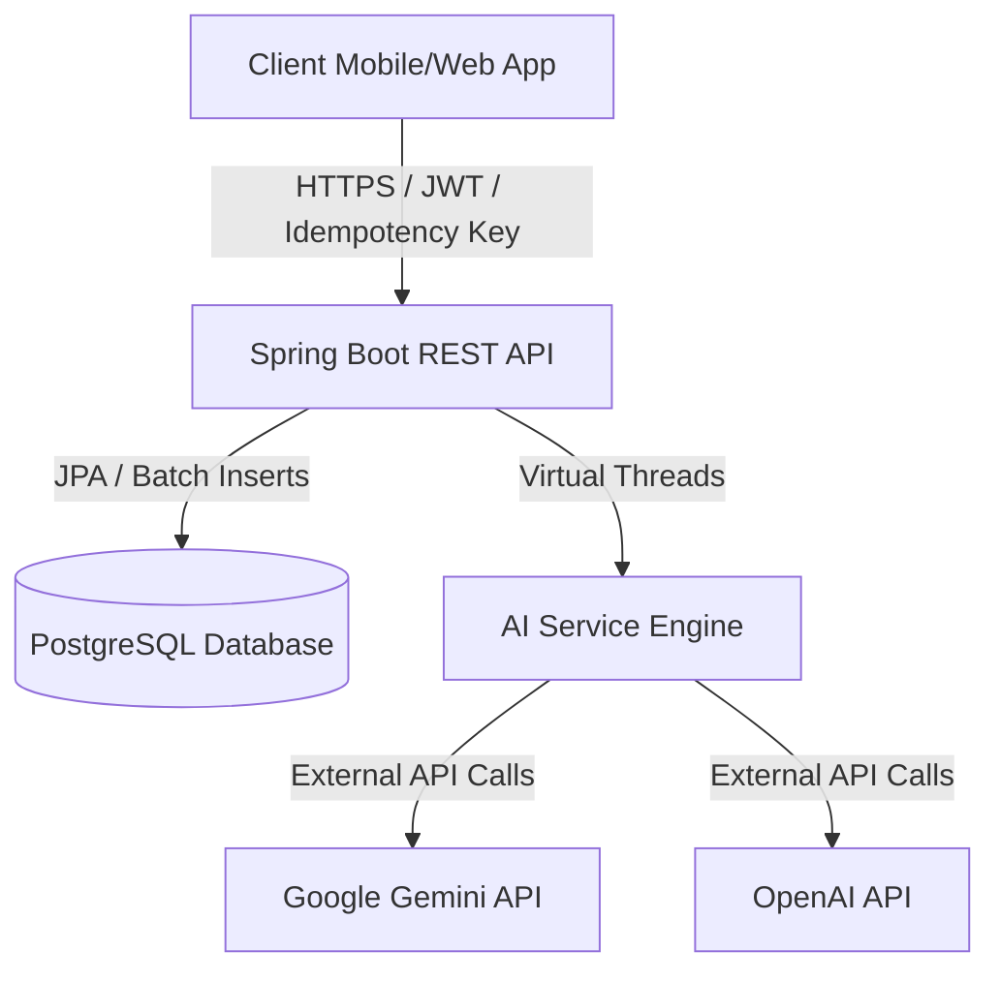
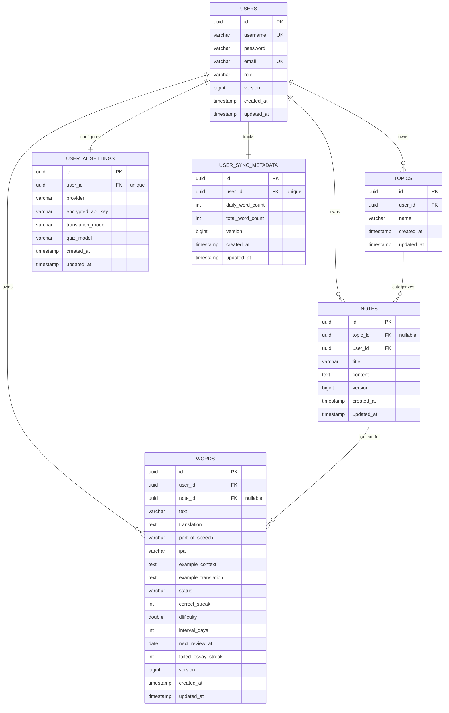

# Business Requirements Document (BRD)
## English Learning Web Application Backend

---

### 1. Document Control
| Version | Date | Author | Description |
| :--- | :--- | :--- | :--- |
| 1.0.0 | 2026-06-28 | Antigravity AI | Initial draft capturing core schema, sync workflows, and AI integration requirements. |

---

### 2. Executive Summary
The **English Learning Web Application** is a specialized platform designed to help users master English vocabulary and contextual writing through structured notes, spaced repetition learning, and customized AI-assisted feedback. 

This document defines the backend business and functional requirements. The backend is designed as a resilient, high-concurrency Spring Boot API that supports client-side offline-first architectures. It facilitates robust batch synchronization with conflict resolution and offloads external AI API calls using lightweight virtual thread pooling for maximum throughput.

---

### 3. Project Vision & Core Goals
- **Personalized Vocabulary Progression**: Utilize an active spaced-repetition algorithm (based on SuperMemo-like parameters) to optimize word retention.
- **Context-driven Learning**: Allow users to link vocabulary directly to personal study notes or essays, providing direct contextual relevance.
- **AI-Powered Assistance**: Support dynamic translation, automatic note topic classification, and granular essay evaluation using user-supplied or system-default Gemini/OpenAI credentials.
- **Offline-First Synchronization**: Allow users to study uninterrupted on client applications, syncing batches of created, updated, or deleted topics, notes, and words seamlessly with the cloud database.

---

### 4. User Personas
1. **Self-Guided Learner (Active Study)**: Focuses on reading articles, writing essays, creating flashcards, and reviewing them based on optimal schedules.
2. **Intermediate/Advanced Writer**: Uses the essay practice feature to write on custom topics, obtaining immediate scores and grammatical corrections.
3. **Multi-device Student**: Switches between mobile and web applications, expecting study lists and custom configuration keys to sync seamlessly.

---

### 5. Architectural & System Context
The backend is built with:
- **Core Technology**: Java 25 (utilizing Project Loom Virtual Threads for parallel I/O blocking tasks) and Spring Boot 4.x.
- **Data Persistence**: PostgreSQL for production transactional data, with optimized batch writing properties.
- **Security**: JWT-based stateless authentication and AES-256 encryption for user-owned API keys.

---

### 6. Functional Requirements

#### 6.1. User Management & Authentication
- **Registration & Login**: Secure registration and password hashing. Issues stateless JWTs.
- **Role-Based Access Control**: Supports roles such as `USER` and `ADMIN` (via `Role` enum).
- **Security Context**: Authenticated users have scoped data ownership. All operations enforce tenancy (users can only access, sync, or modify their own resources).

#### 6.2. Topic & Note Management
- **Topic Hierarchies**: Users organize their learning into Topics (e.g., "Business English", "Toefl Prep").
- **Rich Text Notes**: Users compose notes/essays under specific Topics.
- **Auto-Categorization**: An AI endpoint reads notes and auto-recommends matching topics or suggests new ones.

#### 6.3. Spaced Repetition Vocabulary Engine
- **Word Properties**: Text, IPA notation, Part of Speech, Translation, Contextual Example Sentence, and Example Translation.
- **Learning States**: Words progress through states: `NEW` $\rightarrow$ `LEARNING` $\rightarrow$ `TEMP_REMEMBERED` $\rightarrow$ `MASTERED`.
- **Review Schedule**: Tracks correct streaks, difficulty scores, and calculate the next review date using a Spaced Repetition Algorithm.
- **Linkage**: Vocabulary words can belong to a parent Note, capturing the article or text context from which they were harvested.

#### 6.4. Client-Server Synchronization Engine
To support offline productivity, the backend implements a batch sync protocol:
- **State Merging**: The client submits a single payload (`SyncRequest`) containing arrays of newly added/modified topics, notes, and words, along with lists of deleted entity IDs.
- **Conflict Resolution**: Enforces a version-based conflict check (`dto.version() < entity.getVersion()`). If a client tries to overwrite a newer server record, the server safely ignores the outdated request.
- **Idempotency Protection**: Enforces an idempotency filter using the `X-Idempotency-Key` header. If a duplicate request is received within a 300-second window, the server returns the cached response rather than repeating DB mutations.
- **Metadata Audits**: The system tracks user metrics including `dailyWordCount` and `totalWordCount` to maintain dashboard counters on sync completion.

#### 6.5. User-Controlled AI Service Engine
- **Dual Providers**: Supports Google Gemini and OpenAI as translation and assessment adapters.
- **Flexible Models**: Users can configure which translation and quiz models are used.
- **Self-Provided Keys**: To minimize host operational costs, users can store their own Gemini/OpenAI API keys in `UserAiSettings`, stored encrypted via AES-256.
- **High-Throughput Parallelism**: During bulk translation requests, the system spawns Virtual Threads to run parallel network requests to Gemini/OpenAI, maintaining high throughput under peak loads.

---

### 7. Entity Relationship Diagram (ERD)

The relational schema is configured as follows:

---

### 8. Detailed API Map

| Group | Method | Endpoint | Description | Payload/Params |
| :--- | :--- | :--- | :--- | :--- |
| **Auth** | `POST` | `/api/auth/register` | Register new user account. | `RegisterRequest` |
| **Auth** | `POST` | `/api/auth/login` | Log in and retrieve JWT token. | `LoginRequest` |
| **Sync** | `GET` | `/api/sync/counters` | Get user word count statistics and last sync date. | *None* |
| **Sync** | `POST` | `/api/sync/batch` | Synchronize offline changes. Enforces `X-Idempotency-Key`. | `SyncRequest` |
| **AI** | `POST` | `/api/ai/translate` | Bulk translate/define English words in parallel. | `List<String>` |
| **AI Settings**| `GET` | `/api/ai-settings` | Fetch user-specific API keys and model configurations. | *None* |
| **AI Settings**| `PUT` | `/api/ai-settings` | Store or update user-specific AI model details/keys. | `AiSettingsDto` |

---

### 9. Non-Functional Requirements (NFRs)

#### 9.1. Performance & Concurrency
- **Concurrency Support**: Scalable processing of blocking external network requests (OpenAI/Gemini) through JDK 25 Virtual Threads, preventing pool exhaustion on standard platform threads.
- **Database Optimizations**: Leverages Hibernate batch processing settings (`spring.jpa.properties.hibernate.jdbc.batch_size: 20`) for bulk sync requests to guarantee minimal database round-trips.

#### 9.2. Security & Compliance
- **API Key Security**: Users' personal API keys must not be stored in plaintext. They are encrypted at rest using AES-256 before being stored in the database.
- **Multi-Tenancy Isolation**: The application enforces tenancy checking during sync and database updates. All queries are verified against the token-extracted user ID to prevent unauthorized cross-tenant data leaks.

#### 9.3. Reliability & Fallbacks
- **Idempotency**: API endpoints for synchronization are protected by idempotency layers to handle shaky network connections safely without causing database duplication.
- **AI Fault Tolerance**: Bulk word translation uses concurrent futures. A single failed word translation within a list must be handled gracefully without failing the entire batch translation where possible.

---

### 10. Future Enhancements & Roadmap
1. **Interactive Quiz Generator**: Dynamically generate quizzes based on vocabulary stored in the database.
2. **Offline Audio Sync**: Allow users to save audio pronunciations locally on clients and sync pronunciation stats.
3. **Advanced Writing Feedback**: Enhance the essay assessment framework to pinpoint syntax errors and provide interactive re-write recommendations.
